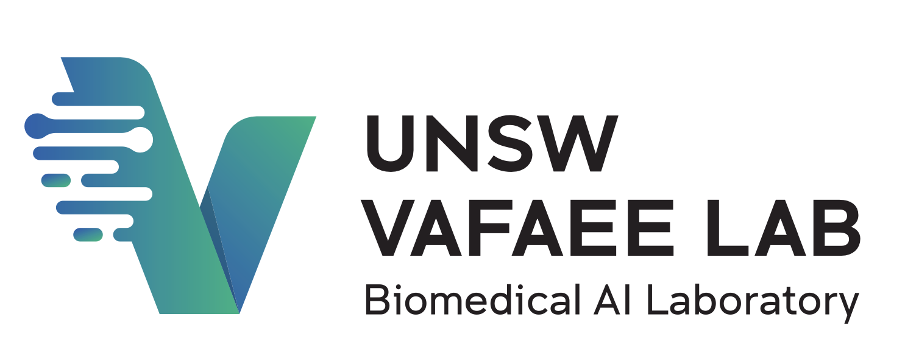

# AlgoraeOS: Curated Drug Combination Dataset

<p align="center">
  <picture>
    <source media="(prefers-color-scheme: dark)" srcset="assets/algorae_logo_reversed.svg">
    
  </picture>
  &nbsp;&nbsp;&nbsp;&nbsp;
  
</p>

<p align="center">
  <a href="https://vafaeelab.github.io/AlgoraeOS_UI/"><b>Prediction portal</b></a> ·
  <a href="https://www.biorxiv.org/content/10.1101/2025.11.05.686895v2"><b>Preprint (bioRxiv)</b></a> ·
  <a href="#dataset"><b>Dataset</b></a> ·
  <a href="#citation"><b>Citation</b></a>
</p>

This repository holds the curated, pre-processed training data behind **AlgoraeOS**. It is released to support
reproducibility and benchmarking against our method.

## About AlgoraeOS

AlgoraeOS is an AI drug-combination discovery platform developed by the
[UNSW Biomedical AI Laboratory (Vafaee Lab)](https://vafaeelab.com/) in partnership with
[Algorae Pharmaceuticals](https://algoraepharma.com/algoraeos/) (ASX: 1AI).

At its core is a biologically informed, attention-aware deep neural network that predicts how two drugs interact in
a given cancer cell line:

- **Four synergy metrics at once.** It predicts Loewe, Bliss, HSA and ZIP together, preserving the relationships
  between them.
- **Calibrated confidence.** Each prediction comes with aleatoric (data) and epistemic (model) uncertainty.
- **Dose-specific.** It reconstructs full dose–response (inhibition) surfaces, not just one averaged score.
- **Biologically grounded inputs.** Drugs are represented by RDKit structural fingerprints and ChemBERTa SMILES
  embeddings. Cell lines are represented by CCLE gene expression passed through a pathway-constrained (MSigDB) layer.
- **Prospectively validated.** In an in vitro screen of an anchor compound that was absent from training, tested with
  24 partner drugs across three cancer cell lines (2,592 dose–combination measurements), predictions preserved
  rank order (Spearman's ρ = 0.51–0.59, P < 0.001). Uncertainty-guided prioritisation improved hit precision.

## Paper

> **Multimodal Deep Learning for Calibrated, Dose-Specific Drug Combination Repurposing: A Prospectively Validated
> AI Framework**
> Muhammad Javad Heydari, Bryan Lye, Parvin Mansouri, Thomas Marsland, Kavya Pamulapati, Robert Vary,
> Hermione Allen, Kaylene J Simpson, John G Lock, James McKenna, Fatemeh Vafaee

Preprint: [bioRxiv 10.1101/2025.11.05.686895](https://www.biorxiv.org/content/10.1101/2025.11.05.686895v2)
(posted under the title *Uncertainty-Aware Deep Learning for Multi-Metric and Dose-Specific Prediction of Drug
Synergy*).

## Dataset

| File | Contents |
|---|---|
| [`data/AlgoraeOS_DrugComb_curated_synergy.csv`](data/AlgoraeOS_DrugComb_curated_synergy.csv) | 359,556 curated drug–drug–cell line combinations (one row each) with synergy scores |
| [`data/drugs.csv`](data/drugs.csv) | The 3,129 drugs in the dataset: DrugComb ID → PubChem CID, name, ChEMBL, DrugBank, InChIKey, SMILES |
| [`data/cell_lines.csv`](data/cell_lines.csv) | The 170 cancer cell lines: DrugComb ID → name, Cellosaurus accession, DepMap ID, CCLE name |

### How it was built

The data come from [DrugComb](https://drugcomb.fimm.fi) v1.5, which harmonises combination-screen metadata,
dose–response formats and SynergyFinder scores. Starting from DrugComb, we:

1. kept dual therapies (drug 1 ≠ drug 2) in cell lines with matched transcriptomic profiles (CCLE);
2. removed records with missing synergy values, DrugComb quality flags, or any synergy score outside [−100, 100];
3. resolved structure discrepancies across DrugComb, DrugBank, PubChem, ChEMBL and MSigDB/KEGG by consensus, and
   excluded only compounds with no recoverable chemical structure;
4. collapsed duplicate (drug 1, drug 2, cell line) triplets using the within-block median.

During training, each combination is also used in swapped order (drug 2, drug 1). That doubles the records seen by
the model, but only one order is stored here. The paper's Methods and Supplementary Note 3 give full details.

### Columns of `AlgoraeOS_DrugComb_curated_synergy.csv`

| Column | Description |
|---|---|
| `block_id` | DrugComb experiment (block) ID |
| `drug_row_id`, `drug_col_id` | DrugComb IDs of drug 1 and drug 2 (look up names in `drugs.csv`) |
| `drug_row_pubchem_cid_single`, `drug_col_pubchem_cid_single` | PubChem CIDs of drug 1 and drug 2 |
| `cell_line_id` | DrugComb cell line ID (look up names in `cell_lines.csv`) |
| `conc_r_unit`, `conc_c_unit` | Concentration units for drug 1 and drug 2 |
| `synergy_zip`, `synergy_loewe`, `synergy_hsa`, `synergy_bliss` | Synergy scores (SynergyFinder), each within [−100, 100] |
| `ic50_row`, `ic50_col` | IC50 of drug 1 and drug 2 |
| `ri_row`, `ri_col` | Relative inhibition of drug 1 and drug 2 alone |
| `css_row`, `css_col`, `css_ri` | Combination sensitivity scores |
| `S_sum`, `S_mean`, `S_max` | Synergy–antagonism (S) scores |
| `quality` | DrugComb quality flag (empty for every row, since flagged records were removed) |

### Loading the data

```python
import pandas as pd

base = "https://raw.githubusercontent.com/VafaeeLab/AlgoraeOS/main/data/"
data = pd.read_csv(base + "AlgoraeOS_DrugComb_curated_synergy.csv")
drugs = pd.read_csv(base + "drugs.csv")
cells = pd.read_csv(base + "cell_lines.csv")

names = drugs.set_index("drugcomb_drug_id")["drug_name"]
data["drug_1"] = data["drug_row_id"].map(names)
data["drug_2"] = data["drug_col_id"].map(names)
data["cell_line"] = data["cell_line_id"].map(cells.set_index("drugcomb_cell_line_id")["cell_line_name"])
```

## Data and code availability

- **Raw data:** the original training data are available from the DrugComb portal: <https://drugcomb.fimm.fi>.
- **Curated data:** this repository.
- **Validation data:** provided in the paper's Supplementary Information (Supplementary Table 11).
- **Predictions:** browse or batch-query AlgoraeOS predictions for 3,000+ drugs across 170 cell lines at
  <https://vafaeelab.github.io/AlgoraeOS_UI/>.
- **Model code:** the full model implementation is proprietary and is not included here.

## Citation

If you use this dataset, please cite the AlgoraeOS paper and DrugComb:

```bibtex
@article{heydari2025algoraeos,
  title   = {Uncertainty-Aware Deep Learning for Multi-Metric and Dose-Specific Prediction of Drug Synergy},
  author  = {Heydari, Muhammad Javad and Lye, Bryan and Mansouri, Parvin and Marsland, Thomas and
             Pamulapati, Kavya and Vary, Robert and Allen, Hermione and Simpson, Kaylene J and
             Lock, John G and McKenna, James and Vafaee, Fatemeh},
  journal = {bioRxiv},
  year    = {2025},
  doi     = {10.1101/2025.11.05.686895}
}
```

DrugComb: Zheng S. *et al.* DrugComb update: a more comprehensive drug sensitivity data repository and analysis
portal. *Nucleic Acids Research* 49, W174–W184 (2021). The data here are derived from DrugComb; please also follow
DrugComb's terms of use.

## Contact

Prof. Fatemeh Vafaee, UNSW Biomedical AI Laboratory: [f.vafaee@unsw.edu.au](mailto:f.vafaee@unsw.edu.au)
