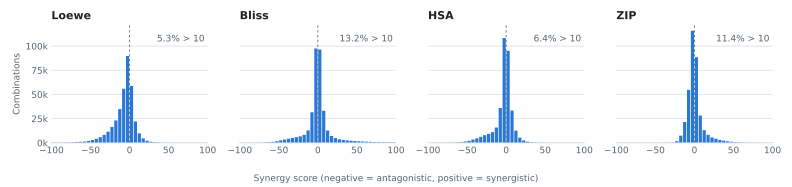
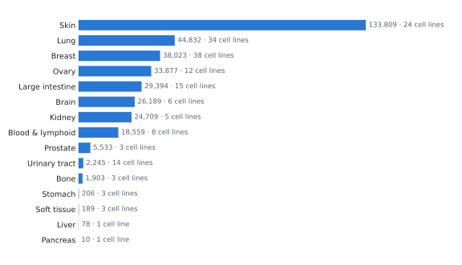
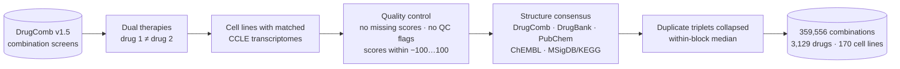

<div align="center">

<a href="https://algoraepharma.com/algoraeos/">
  <picture>
    <source media="(prefers-color-scheme: dark)" srcset="assets/algorae_logo_reversed.svg">
    
  </picture>
</a>
&nbsp;&nbsp;&nbsp;&nbsp;&nbsp;&nbsp;
<a href="https://vafaeelab.com/">
  <picture>
    <source media="(prefers-color-scheme: dark)" srcset="assets/vafaee_lab_logo_dark.png">
    
  </picture>
</a>

# AlgoraeOS

### Curated drug combination dataset for calibrated, dose-specific synergy prediction

[](https://vafaeelab.github.io/AlgoraeOS_UI/)
[](https://www.biorxiv.org/content/10.1101/2025.11.05.686895v2)


[**Overview**](#overview) · [**Dataset**](#the-dataset) · [**Quick start**](#quick-start) · [**How it was built**](#how-the-dataset-was-built) · [**Availability**](#data-and-code-availability) · [**Citation**](#citation)

</div>

---

## Overview

**AlgoraeOS** is an AI drug-combination discovery platform developed by the
[UNSW Biomedical AI Laboratory (Vafaee Lab)](https://vafaeelab.com/) in partnership with
[Algorae Pharmaceuticals](https://algoraepharma.com/algoraeos/) (ASX: 1AI). At its core is a biologically informed,
attention-aware deep neural network that predicts how two drugs interact in a given cancer cell line.

This repository releases the **curated, pre-processed training data** behind AlgoraeOS to support reproducibility
and benchmarking against our method. The model itself is proprietary; its predictions can be explored in the
[**AlgoraeOS prediction portal**](https://vafaeelab.github.io/AlgoraeOS_UI/).

<table>
<tr>
<td width="33%" valign="top">

**🎯 Four metrics at once**

Jointly predicts Loewe, Bliss, HSA and ZIP synergy, preserving the relationships between them.

</td>
<td width="33%" valign="top">

**📏 Calibrated confidence**

Every prediction carries aleatoric (data) and epistemic (model) uncertainty.

</td>
<td width="33%" valign="top">

**💊 Dose-specific**

Reconstructs full dose–response surfaces at single-concentration resolution, not one averaged score.

</td>
</tr>
<tr>
<td valign="top">

**🧬 Biologically grounded**

Drugs: RDKit fingerprints + ChemBERTa SMILES embeddings. Cell lines: CCLE expression through a pathway-constrained
(MSigDB) layer.

</td>
<td valign="top">

**🧪 Prospectively validated**

An anchor compound absent from training, screened with 24 partners in 3 cancer cell lines (2,592 measurements):
rank order preserved, Spearman's ρ = 0.51–0.59 (P < 0.001).

</td>
<td valign="top">

**📈 Trained at scale**

~5.5 million dose-specific inhibition records and 736,246 order-augmented synergy records from DrugComb.

</td>
</tr>
</table>

## The dataset

| File | Rows | What it contains |
|---|---:|---|
| [`data/AlgoraeOS_DrugComb_curated_synergy.csv`](data/AlgoraeOS_DrugComb_curated_synergy.csv) | 359,556 | One row per drug–drug–cell line combination, with four synergy scores and monotherapy summaries |
| [`data/drugs.csv`](data/drugs.csv) | 3,129 | DrugComb drug ID → PubChem CID, name, ChEMBL, DrugBank, InChIKey, SMILES |
| [`data/cell_lines.csv`](data/cell_lines.csv) | 170 | DrugComb cell line ID → name, tissue, Cellosaurus accession, DepMap ID, CCLE name |

Full column descriptions are in the [data dictionary](data/README.md).

### Synergy score distributions

<picture>
  <source media="(prefers-color-scheme: dark)" srcset="assets/figures/synergy_distributions_dark.svg">
  
</picture>

### Coverage by tissue

<picture>
  <source media="(prefers-color-scheme: dark)" srcset="assets/figures/tissue_coverage_dark.svg">
  
</picture>

## Quick start

<details open>
<summary><b>Python (pandas)</b></summary>

```python
import pandas as pd

base = "https://raw.githubusercontent.com/VafaeeLab/AlgoraeOS/main/data/"
data = pd.read_csv(base + "AlgoraeOS_DrugComb_curated_synergy.csv")
drugs = pd.read_csv(base + "drugs.csv").set_index("drugcomb_drug_id")
cells = pd.read_csv(base + "cell_lines.csv").set_index("drugcomb_cell_line_id")

data["drug_1"] = data["drug_row_id"].map(drugs["drug_name"])
data["drug_2"] = data["drug_col_id"].map(drugs["drug_name"])
data["cell_line"] = data["cell_line_id"].map(cells["cell_line_name"])
data["tissue"] = data["cell_line_id"].map(cells["tissue"])

print(data[["drug_1", "drug_2", "cell_line", "synergy_bliss", "synergy_zip"]].head())
```

</details>

<details>
<summary><b>R</b></summary>

```r
base  <- "https://raw.githubusercontent.com/VafaeeLab/AlgoraeOS/main/data/"
data  <- read.csv(paste0(base, "AlgoraeOS_DrugComb_curated_synergy.csv"))
drugs <- read.csv(paste0(base, "drugs.csv"))
cells <- read.csv(paste0(base, "cell_lines.csv"))

data$drug_1    <- drugs$drug_name[match(data$drug_row_id, drugs$drugcomb_drug_id)]
data$drug_2    <- drugs$drug_name[match(data$drug_col_id, drugs$drugcomb_drug_id)]
data$cell_line <- cells$cell_line_name[match(data$cell_line_id, cells$drugcomb_cell_line_id)]
head(data[, c("drug_1", "drug_2", "cell_line", "synergy_bliss", "synergy_zip")])
```

</details>

A runnable version with a few summary statistics is in [`examples/quickstart.py`](examples/quickstart.py).

## How the dataset was built



1. **Source.** [DrugComb](https://drugcomb.fimm.fi) v1.5 harmonises combination-screen metadata, dose–response formats
   and SynergyFinder scores; each experiment is a (drug A, drug B, cell line) concentration-grid block.
2. **Scope.** Dual therapies in cell lines with matched transcriptomic profiles. The transcriptome requirement is a model
   input, not a quality filter, and accounts for most excluded records.
3. **Quality control.** Records with missing synergy values, DrugComb quality flags or any score outside [−100, 100]
   were removed. Quality- and structure-related exclusions together removed only 3.15% of the dual-therapy corpus.
4. **Chemistry.** Structure discrepancies were reconciled by consensus, resolving 4,305 of 4,328 compounds (99.47%);
   only compounds with no recoverable structure were excluded.
5. **Deduplication.** Duplicate triplets were collapsed using the within-block median. During training each combination
   is also used in swapped order (drug 2, drug 1), giving 736,246 records; only one order is stored here.

Full details: the paper's Methods, Supplementary Note 3 and Supplementary Figure 19.

## Data and code availability

| | |
|---|---|
| 🗃️ **Raw data** | The original training data are available from the DrugComb portal: <https://drugcomb.fimm.fi> |
| 📦 **Curated data** | This repository |
| 🧪 **Validation data** | The paper's Supplementary Information (Supplementary Table 11) |
| 🔎 **Predictions** | Single and batch queries for 3,000+ drugs across 170 cell lines: <https://vafaeelab.github.io/AlgoraeOS_UI/> |
| 🔒 **Model code** | The full model implementation is proprietary and is not included |

## Paper

> **Multimodal Deep Learning for Calibrated, Dose-Specific Drug Combination Repurposing: A Prospectively Validated AI
> Framework**
>
> Muhammad Javad Heydari, Bryan Lye, Parvin Mansouri, Thomas Marsland, Kavya Pamulapati, Robert Vary,
> Hermione Allen, Kaylene J Simpson, John G Lock, James McKenna, Fatemeh Vafaee
>
> UNSW Sydney · Peter MacCallum Cancer Centre · University of Melbourne · Algorae Pharmaceuticals · UNSW AI Institute

Preprint: [bioRxiv 10.1101/2025.11.05.686895](https://www.biorxiv.org/content/10.1101/2025.11.05.686895v2),
posted under the title *Uncertainty-Aware Deep Learning for Multi-Metric and Dose-Specific Prediction of Drug Synergy*.

## Citation

If you use this dataset, please cite the AlgoraeOS paper and DrugComb. GitHub's **Cite this repository** button (in
the sidebar) gives the same reference in APA and BibTeX.

```bibtex
@article{heydari2025algoraeos,
  title   = {Uncertainty-Aware Deep Learning for Multi-Metric and Dose-Specific Prediction of Drug Synergy},
  author  = {Heydari, Muhammad Javad and Lye, Bryan and Mansouri, Parvin and Marsland, Thomas and
             Pamulapati, Kavya and Vary, Robert and Allen, Hermione and Simpson, Kaylene J and
             Lock, John G and McKenna, James and Vafaee, Fatemeh},
  journal = {bioRxiv},
  year    = {2025},
  doi     = {10.1101/2025.11.05.686895}
}

@article{zheng2021drugcomb,
  title   = {DrugComb update: a more comprehensive drug sensitivity data repository and analysis portal},
  author  = {Zheng, Shuyu and others},
  journal = {Nucleic Acids Research},
  volume  = {49},
  number  = {W1},
  pages   = {W174--W184},
  year    = {2021},
  doi     = {10.1093/nar/gkab438}
}
```

The data are derived from DrugComb; please also follow DrugComb's terms of use.

## Repository layout

```
AlgoraeOS/
├── data/
│   ├── AlgoraeOS_DrugComb_curated_synergy.csv   # the curated combinations
│   ├── drugs.csv                                # drug ID → names and identifiers
│   ├── cell_lines.csv                           # cell line ID → name, tissue, identifiers
│   └── README.md                                # data dictionary
├── examples/quickstart.py                       # load, join names, summarise
├── scripts/make_figures.py                      # regenerates the figures above
├── assets/                                      # logos and figures
└── CITATION.cff                                 # "Cite this repository" metadata
```

## Acknowledgements

AlgoraeOS was developed by the UNSW Biomedical AI Laboratory in partnership with Algorae Pharmaceuticals, with
prospective validation by the Victorian Centre for Functional Genomics at the Peter MacCallum Cancer Centre. We thank
the DrugComb team for making their data openly available.

## Contact

**Prof. Fatemeh Vafaee**, UNSW Biomedical AI Laboratory, [f.vafaee@unsw.edu.au](mailto:f.vafaee@unsw.edu.au)
Questions about the dataset? [Open an issue](https://github.com/VafaeeLab/AlgoraeOS/issues).

<div align="center">
<sub>© UNSW Biomedical AI Laboratory × Algorae Pharmaceuticals · For research use only</sub>
</div>
